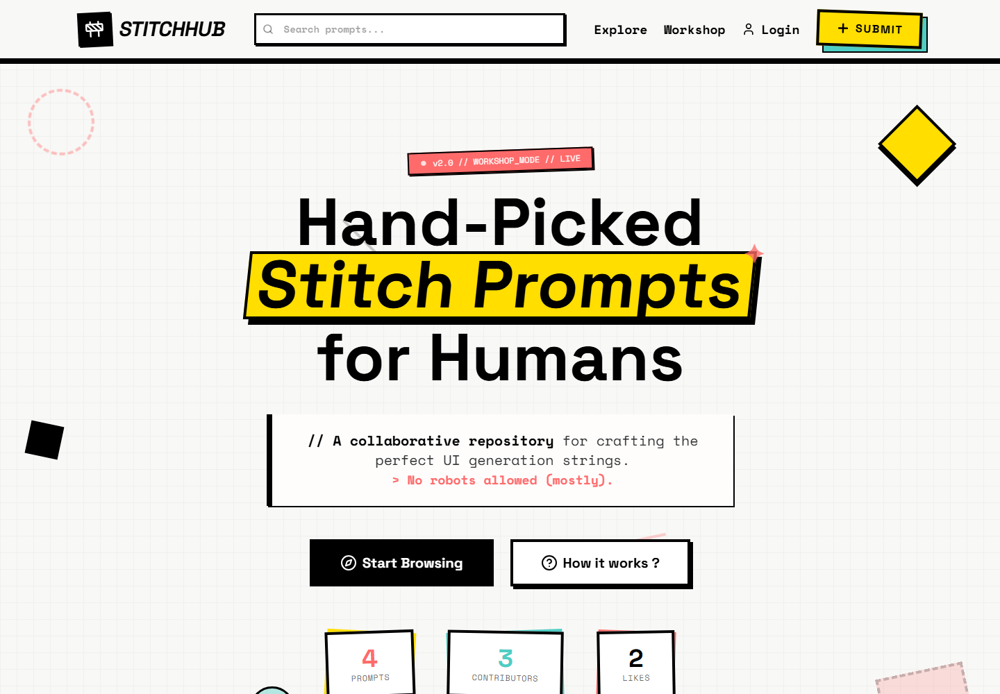

# StitchHub

> **English:** A community gallery for sharing UI designs together with their prompts and code. Built with Next.js, TypeScript and Supabase, with public discovery, creator profiles and authenticated publishing.

[Demo](https://stitch-hub-one.vercel.app) · [CI](https://github.com/luchonicolini/StitchHub/actions/workflows/quality.yml)

[](https://github.com/luchonicolini/StitchHub/actions/workflows/quality.yml)

Una imagen de una interfaz no explica cómo fue construida.
StitchHub reúne diseños, prompts y fragmentos de código para explorar referencias, comprender su proceso y compartir el trabajo de cada creador.

**Estado:** producto personal en desarrollo con una demo pública. Las capacidades autenticadas requieren un proyecto Supabase configurado.

## Vista previa



## Funcionalidades

- Feed de diseños, búsqueda y filtros por categoría.
- Publicaciones con imágenes, prompts y fragmentos de código.
- Perfiles públicos y edición de publicaciones propias.
- Registro, inicio y recuperación de sesión.
- Likes, guardados, seguimiento de creadores y notificaciones.
- Interfaz adaptable con una dirección visual de bordes marcados y alto contraste.

## Stack y arquitectura

| Área | Implementación |
| --- | --- |
| Aplicación | Next.js 16, App Router, React 19 y TypeScript |
| UI | Tailwind CSS, Framer Motion y componentes por funcionalidad |
| Backend | Supabase: acceso a datos, autenticación y almacenamiento |
| Estado cliente | Hooks y Zustand |
| Observabilidad | Integraciones de Sentry y Vercel |
| Calidad | ESLint, TypeScript y Playwright; workflow existente en Ubuntu |

El renderizado del servidor carga los datos iniciales y los componentes cliente manejan las interacciones.
Las acciones del servidor y rutas API coordinan operaciones que requieren contexto de sesión.
La configuración de Supabase y sus políticas es parte del entorno necesario, no una capacidad suministrada por clonar el frontend.

| Ubicación | Responsabilidad |
| --- | --- |
| `src/app/` | Rutas, acciones del servidor, callbacks y endpoints |
| `src/components/` | Autenticación, perfiles, publicaciones y galería |
| `src/hooks/` | Estado e interacciones reutilizables |
| `src/lib/` | Clientes y utilidades de datos y carga de archivos |
| `src/types/` | Tipos de datos y transformaciones |
| `e2e/` | Escenarios públicos y autenticados de Playwright |
| Archivos SQL de la raíz | Referencias de esquema; no sustituyen una migración completa verificada |

## Cómo ejecutarlo

1. Instalá Node.js 22 y npm.
2. Cloná e instalá las dependencias del lockfile:

   ```bash
   git clone https://github.com/luchonicolini/StitchHub.git
   cd StitchHub
   npm ci
   ```

3. Creá `.env.local` en la raíz con los valores de un entorno Supabase de desarrollo:

   ```dotenv
   NEXT_PUBLIC_SUPABASE_URL=[COMPLETAR: URL del proyecto Supabase de desarrollo]
   NEXT_PUBLIC_SUPABASE_ANON_KEY=[COMPLETAR: clave pública anon del entorno de desarrollo]
   ```

4. Configurá en ese entorno el esquema, las políticas de acceso, Storage y los redirects de autenticación que necesita la app.
   Revisá `setup_database.sql`, `create_followers.sql`, `create_notifications.sql` y los tipos del repositorio como referencia.
   **[COMPLETAR: procedimiento reproducible y verificado de preparación de Supabase, incluidos buckets, políticas y redirects]**
5. Iniciá el frontend:

   ```bash
   npm run dev
   ```

6. Abrí [localhost:3000](http://localhost:3000).

La ruta de eliminación de cuenta utiliza `SUPABASE_SERVICE_ROLE_KEY` exclusivamente en el servidor.
Para probar esa operación, configurala en el entorno privado del servidor; no uses el prefijo `NEXT_PUBLIC_`.
Las variables de Sentry son opcionales para la observabilidad; consultá los archivos `sentry.*.config.ts` y `src/instrumentation-client.ts`.
No se incluyen credenciales reales.

## Pruebas y CI

```bash
npm run lint
npx tsc --noEmit
npm run build
npx playwright install chromium
npm run test:e2e
```

Playwright inicia la compilación de producción en `http://127.0.0.1:3100`.
Para ejecutar los escenarios autenticados, definí `E2E_USER_EMAIL` y `E2E_USER_PASSWORD` en el entorno del proceso de pruebas,
con una cuenta dedicada de desarrollo. Esos tests pueden crear, editar y borrar publicaciones de esa cuenta.

El [workflow existente](.github/workflows/quality.yml) ejecuta lint, tipos, build y Playwright.
Requiere los secretos `NEXT_PUBLIC_SUPABASE_URL`, `NEXT_PUBLIC_SUPABASE_ANON_KEY`,
`E2E_USER_EMAIL` y `E2E_USER_PASSWORD`.
Los escenarios autenticados se omiten si faltan sus credenciales; un caso público también puede omitirse si no hay un perfil disponible.
Un resultado verde con casos omitidos no equivale a cobertura de esos flujos.

## Próximos pasos

- Documentar y verificar la preparación completa de un entorno de desarrollo.
- Ampliar las pruebas de permisos y errores de publicación.
- Revisar accesibilidad de navegación y formularios.
- Mantener separadas las cuentas y los datos usados por tests.

## Pendientes de configuración

- [COMPLETAR: URL del proyecto Supabase de desarrollo]
- [COMPLETAR: clave pública anon del entorno de desarrollo]
- [COMPLETAR: procedimiento reproducible y verificado de preparación de Supabase, incluidos buckets, políticas y redirects]

## Autor

[Luciano Nicolini](https://github.com/luchonicolini) · iOS Developer (Swift, SwiftUI), con experiencia full stack en proyectos con Next.js y Supabase.
